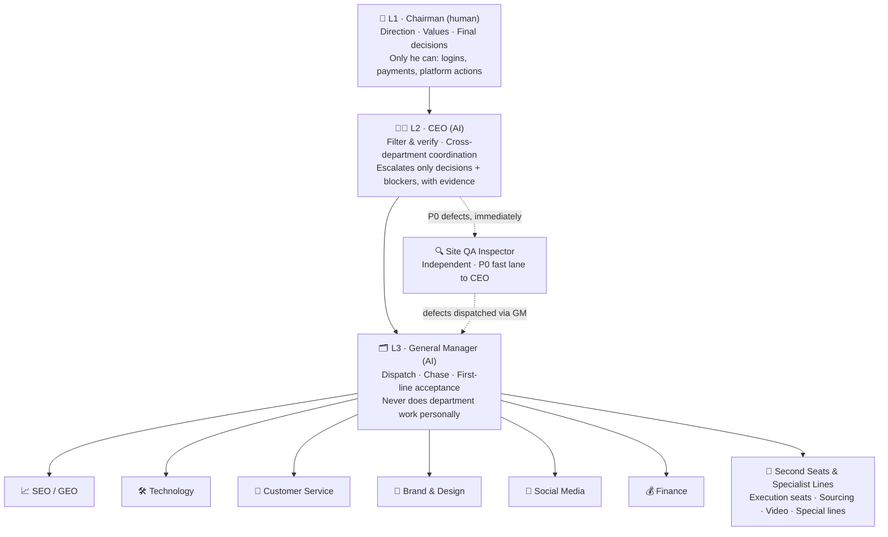

<div align="center">

# AI 公司架构如何搭建 · How to Build an AI-Native Company

**The operating architecture of AstroAndCharm — how the company was structured, and how work actually gets executed inside it, in detail.**

[](https://astroandcharm.com)
[](#-about-this-public-edition)
[](#-the-architecture-at-a-glance)
[](#-vision)

[English](./README.md) · [简体中文](./README.zh-CN.md)

</div>

> This is not a company brochure. It is a **deployment record**: the layer design, the reporting chains, the authorization tiers, the daily cadence, the acceptance checklists — the granularity at which a one-person, AI-staffed company is actually run.

---

## 📖 Table of Contents

- [About This Public Edition](#-about-this-public-edition)
- [The Architecture at a Glance](#-the-architecture-at-a-glance)
- [How It Was Deployed](#-how-it-was-deployed)
- [How Execution Flows](#-how-execution-flows)
- [The Granularity Standard](#-the-granularity-standard)
- [Values](#-values)
- [Repository Structure](#-repository-structure)
- [References](#-references)

---

## 🌐 About This Public Edition

AstroAndCharm is a bracelet-led cross-border DTC brand. Behind the store sits an unusual org: **one human chairman, an AI CEO, an AI general manager, and AI specialist departments** — deployed in October 2026 and run daily since.

This public edition shares the *architecture and execution system* in full operational detail. What it deliberately omits: revenue and traffic targets, margins, supplier costs, customer data, and anything personal. The complete internal handbook (with targets and live numbers) is kept in a private repository.

**Who this is for:** solo founders, indie hackers, and anyone asking *"if AI agents are the staff, what does the management system have to look like for that to actually work?"*

---

## 🧭 The Architecture at a Glance

Four layers. No layer reports to its own layer. Every person/agent has exactly **one** reporting line.



| Layer | Deployed as | One-line job |
|---|---|---|
| **L1 Chairman** | The founder himself | Decide direction; be the only hands on accounts, money and final approvals |
| **L2 CEO** | One AI executive session | Turn the chairman's intent into coordinated execution; turn department noise into verified, decision-ready summaries |
| **L3 General Manager** | One AI manager session per project | Own one project's plan, dispatch, chasing and acceptance — a single throat for all departments |
| **L4 Departments** | One AI session per department, plus a second seat per busy line | Execute inside a written mandate; report only upward to the GM |

Why four layers and not two? A flat "founder talks to every agent" design collapsed under its own message volume within days. Each layer exists to **compress information as it rises and expand instructions as they descend** — see [`docs/01-deployment.md`](./docs/01-deployment.md).

---

## 🚀 How It Was Deployed

Deployment happened in deliberate steps, each one only after the previous layer proved it could hold weight:

| Step | What was deployed | The detail that made it work |
|---|---|---|
| 1 | **Values & vision first** | Seven written values were settled *before* scaling execution — they later became the authorization floor: anything inside them needs no per-item approval |
| 2 | **Chairman → GM link** | A single GM session was appointed to coordinate all departments, so the founder stopped managing departments directly |
| 3 | **Six departments** | SEO/GEO, Technology, Customer Service, Brand & Design, Social Media, Finance — each with a written mandate: what it owns, what it explicitly does *not* own |
| 4 | **Second seats** | Busy lines got a second seat (execution) under the *GM*, not under the department manager — managers keep judgment, second seats keep throughput, and neither can quietly become a shadow chain |
| 5 | **CEO layer inserted** | When two projects ran in parallel, a CEO layer was inserted above the GMs: GMs report to the CEO, the CEO alone faces the chairman |
| 6 | **Independent QA** | A QA inspector reporting to the CEO (not to the GM it inspects), with a P0 fast lane that bypasses the chain |
| 7 | **Special lines** | Time-boxed specialist lines (sourcing, a product line with direct chairman decisions) are attached to a GM explicitly, never left floating |
| 8 | **Naming & tagging** | Every staff conversation is prefixed by company (`Astro · …`). Multi-company staff are never mixed — an agent belongs to exactly one company tag |

Full deployment notes, including the failure modes each step fixed: [`docs/01-deployment.md`](./docs/01-deployment.md)

---

## 🔄 How Execution Flows

A unit of work travels a fixed loop. No step may be skipped, and "done" is a status somebody *else* grants you.

```mermaid
flowchart LR
    A["1 · Intent<br/>Chairman decides /<br/>values floor covers it"] --> B["2 · CEO framing<br/>Scope, evidence needs,<br/>which GM owns it"]
    B --> C["3 · GM dispatch<br/>Numbered item in the<br/>master sheet + department task"]
    C --> D["4 · Department execution<br/>Inside mandate ·<br/>evidence attached"]
    D --> E["5 · GM acceptance<br/>Checks against the<br/>dispatch spec, item by item"]
    E --> F["6 · QA re-verification<br/>Independent check on<br/>the live surface"]
    F --> G["7 · CEO summary<br/>Four-quadrant label ·<br/>result + sheet link"]
    G --> H["8 · Chairman feedback<br/>Approval column in<br/>the master sheet"]
    H -. "corrections re-enter as new numbered items" .-> C
```



**The daily rhythm that drives the loop**

| Beat | Granularity |
|---|---|
| Morning | GM files a **written daily plan** (numbered items, owners, expected outputs) |
| Twice daily | Department progress reports — in-flight items in parallel, **blockers in a separate section**, never mixed into progress |
| Evening | GM files a **daily summary measured against the morning plan**, item by item — not a fresh narrative |
| CEO review, twice daily | Plan checked in the morning; summary checked against the plan at night; discrepancies are named, not smoothed over |
| Chairman's pass | He reads one consolidated summary (decisions on top, then items grouped by priority quadrant, sheet links attached) and approves **inside the sheet** |

The full cadence, the master-sheet protocol (one new dated approval column per day, fresh-read before write, read-back after write, closing scan of every approval line) is in [`docs/03-execution-system.md`](./docs/03-execution-system.md). Copy-paste templates are in [`docs/06-templates.md`](./docs/06-templates.md).

---

## 🔬 The Granularity Standard

"Done well" is defined down to the measurement, not left as a vibe. Examples — the full set is in [`docs/05-quality-gates.md`](./docs/05-quality-gates.md):

- **Acceptance is measured on the canonical URL only** — no cache-busting parameters, measured repeatedly, cross-checked against an independent QA measurement.
- **A position is verified twice:** coordinates *and* semantic placement against the approved mock ("in the white band below the header" is a different claim from "at y = 630").
- **Every site delivery ships with a ~390px mobile check.** No mobile evidence, no acceptance.
- **Visitor-facing changes are verified in anonymous raw HTML**, not only in a logged-in view.
- **A plugin ships only after three machine checks** — line-by-line diff vs the last good version, per-line quote-balance audit, byte-level checks — and is re-verified on homepage / admin / checkout within minutes of install, with a rehearsed rollback.
- **A number without a source is not a number.** Department reports cite where every figure came from, or it is sent back.
- **A blocker older than a day is reported on its own line**: where it is stuck, for how long, waiting on whom. Never buried in a progress paragraph.
- **Authority follows error rate.** Sustained clean runs expand a line's autonomy; repeated errors shrink it. The same mistake is never made twice — it becomes a written rule.

---

## 💎 Values

The authorization floor the whole system runs on (settled before scale-up):

1. **No quick money** — long-term assets only.
2. **Say it, do it** — promises to customers and inside the team are kept as written.
3. **Evidence first, conclusions last** — diagnose read-only before touching anything.
4. **Honest, no fudging** — no fake discounts, no guaranteed results, no invented credentials.
5. **Wrong decision? Fix it on the spot** — settled calls get reversed openly when proven wrong.
6. **Product is the purpose, content is the means** — content earns trust; the product is the business.
7. **Support people, never lower the bar** — corrections are direct; trust is not withdrawn afterwards.

Vision: *set by the founder, in one sentence — where this company will stand in ten years, and what it will look like when it gets there. Write yours before you scale; the whole authorization system in this handbook hangs on it. (Our own vision is kept in the private handbook.)*

---

## 📂 Repository Structure

```text
how-to-build-an-ai-company/
├── README.md                    # This deployment record
├── README.zh-CN.md              # 中文版
├── LICENSE.md                   # CC BY 4.0 — reuse with attribution
└── docs/
    ├── 01-deployment.md         # How the architecture was deployed, step by step
    ├── 02-org-architecture.md   # Layers, roles, mandates, boundaries
    ├── 03-execution-system.md   # Cadence, master-sheet protocol, priority quadrants
    ├── 04-task-lifecycle.md     # One task's full journey, handoffs & acceptance
    ├── 05-quality-gates.md      # The granularity standard, as checklists
    └── 06-templates.md          # Plan / summary / escalation / QA / blocker templates
```

---

## 📚 References

- **GitLab Handbook** — the handbook-first, single-source-of-truth model this system borrows.
- **Awesome README** — the front-door format (banner, badges, TOC, Mermaid, docs split).
- Our private internal handbook — same architecture, plus targets and live operating numbers.

---

<div align="center">

*AstroAndCharm — Public Handbook Edition · v1.0 · November 2026 · Licensed CC BY 4.0: steal this operating system, credit the source.*

</div>
